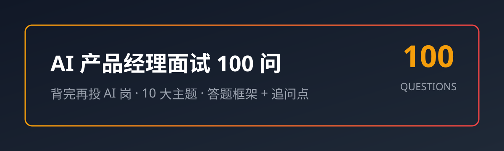

# AI 产品经理面试 100 问——背完再投 AI 岗 🎯

> **AI 时代的产品经理，面试到底考什么？** 从"你做过什么产品"变成"你怎么设计一个 AI 功能"——大模型原理、Prompt 设计、模型评估、落地成本、开放设计题，一个都躲不掉。
>
> 这份手册把 AI 产品经理面试**最高频的 100+ 问**整理成册，每题都有**答题框架（3-6 条，可直接背）+ 追问点（面试官顺着会问什么）**。分三级标注：【基础】【进阶】【实战】——从校招到社招全覆盖。

`ai-pm-interview-zh` 是一份**纯 Markdown 的中文 AI 产品经理面试题库**：打开就能背、按主题分文件、答案精简实用。

⭐ 如果对你有帮助，点个 Star 支持中文开源

## 为什么值得收藏

- 📚 **10 大主题全覆盖**：行业认知 / 大模型原理 / Prompt·RAG·Agent / 产品设计 / 模型评估 / 数据训练 / 商业化 / 团队协作 / 开放设计题 / 职业素养——AI PM 面试能考的，这里都有。
- 🎯 **每题都有答题框架**：答案要点控制在 3-6 条，一句话一个得分点，不啰嗦。
- 🔍 **追问点设计**：每个问题后面附 1-3 个面试官可能的追问，提前准备好，面试不慌。
- 📊 **三级难度分级**：【基础】校招必考、【进阶】社招核心、【实战】拉开差距。
- ✍️ **全原创中文措辞**：不搬运任何教程原文，以真实面试经验为准。

## 速查索引（想刷哪块 → 打开哪篇）

| 主题 | 题数 | 适合谁 |
| --- | --- | --- |
| [01 AI 行业与基础认知](topics/01-industry-basics.md) | 10 问 | 所有人，开场必问 |
| [02 大模型原理与能力边界](topics/02-llm-fundamentals.md) | 10 问 | 想讲清楚"为什么"的 |
| [03 Prompt / RAG / Agent](topics/03-prompt-rag-agent.md) | 10 问 | 做 AI 应用的必考 |
| [04 AI 产品设计与落地](topics/04-product-design.md) | 10 问 | 产品经理核心能力 |
| [05 模型评估与指标](topics/05-evaluation-metrics.md) | 10 问 | 做效果的必考 |
| [06 数据、训练与微调](topics/06-data-training-finetuning.md) | 10 问 | 与技术协作必懂 |
| [07 商业化与成本](topics/07-commercialization-cost.md) | 10 问 | 社招/高级岗高频 |
| [08 团队协作与项目管理](topics/08-collaboration-project.md) | 10 问 | 人人要会 |
| [09 开放设计题与案例](topics/09-open-design-cases.md) | 10 问 | 面试压轴/拉开差距 |
| [10 职业素养与软性题](topics/10-soft-skills.md) | 10 问 | 终面必问 |

## 难度分级说明

- 【基础】：概念题，必须脱口而出。考不到就是送分题，答不上基本凉。
- 【进阶】：原理题，需要讲清楚"为什么"。区分背过和真懂的。
- 【实战】：场景/设计/案例题，考察产品判断力和落地能力。拉开差距的题。

## 使用建议

1. **面试前 1 周**：先过一遍所有【基础】题，确保每道都能说出来。
2. **面试前 3 天**：重点刷【进阶】和目标岗位方向的【实战】题。
3. **面试前 1 天**：把目标公司面经里提到的主题，对照这份手册再过一遍。
4. **平时积累**：Star 收藏，遇到新的面试题欢迎提 Issue 补充。

## 题目格式示例

```markdown
### Q4 【进阶】你怎么判断一个需求"该不该用 AI"？

- **答题框架**：
  1. 先判断问题是否真实、频率与规模是否值得投入。
  2. 再看任务是否适合 AI：模式识别/生成/理解类适合，确定性计算与强规则类不一定。
  3. 评估成本与收益：错误代价、延迟要求、维护成本 vs 节省的人力。
  4. 结论导向：能用规则/关键词解决的，就别硬上大模型。
- **追问点**：
  - 举个例子说明一个"不该用 AI"的场景？
  - AI 方案的失败边界你怎么定义？
```

每道题都长这样：**题目 → 答题框架（可直接背）→ 追问点（提前准备）**。

## 手册结构

```
ai-pm-interview-zh/
├── topics/                    # 10 个主题题库
│   ├── 01-industry-basics.md
│   ├── 02-llm-fundamentals.md
│   ├── 03-prompt-rag-agent.md
│   ├── 04-product-design.md
│   ├── 05-evaluation-metrics.md
│   ├── 06-data-training-finetuning.md
│   ├── 07-commercialization-cost.md
│   ├── 08-collaboration-project.md
│   ├── 09-open-design-cases.md
│   └── 10-soft-skills.md
├── assets/
│   └── banner.svg              # 原创横幅
├── SOURCES.md                  # 外部参考来源与许可
├── LICENSE                     # MIT License
└── README.md
```

## 质量承诺

- ✅ 每题答案经过 AI 产品从业经验自查，概念/流程确保正确
- ✅ 无占位符、无"待补充"——打开就能背
- ✅ 全原创中文措辞，只参考外部资料的覆盖面与思路
- ❓ 发现错误？开 [Issue](https://github.com/zieang88888/ai-pm-interview-zh/issues)，核实后第一时间修正

## 星标理由（认真脸）

AI 产品岗面经更新快、坑位卷——**准备的时候觉得"我懂"，坐在面试官对面支支吾吾**。
Star 一下，面试前翻两遍，比临时刷帖强十倍。⭐

## License

[MIT](LICENSE) © zieang88888

---

*整理不易，希望每一个想转 AI 产品经理的同学，都拿到心仪的 offer。*

## 姊妹项目

中文开源矩阵，一网打尽开发者的知识库：

- [zhskills · 中文技能库](https://github.com/zieang88888/zhskills)
- [awesome-ai-tools-zh · AI 工具导航](https://github.com/zieang88888/awesome-ai-tools-zh)
- [llm-interview-zh · 大模型面试题库](https://github.com/zieang88888/llm-interview-zh)
- [cursor-tutorial-zh · Cursor 中文教程](https://github.com/zieang88888/cursor-tutorial-zh)
- [free-programming-books-zh · 编程书籍大全](https://github.com/zieang88888/free-programming-books-zh)
- [system-design-zh · 系统设计面试](https://github.com/zieang88888/system-design-zh)
- [office-cheatsheet-zh · 办公效率速查](https://github.com/zieang88888/office-cheatsheet-zh)
